# Antigravity AI Platform — House of Intelligence & Product Playground

[](https://fastapi.tiangolo.com)
[](https://react.dev/)
[](https://pytorch.org/)
[](https://vite.dev/)
[]()
[](https://developer.nvidia.com/cuda-toolkit)
[](LICENSE)

A production-grade, full-stack autonomous AI platform combining a **from-scratch decoder-only causal Transformer (`SmallGPT`)**, an **autonomous SWE-bench-style coding agent with verified sandbox execution**, and a unified **"House of Intelligence"** that trains, monitors, hot-swaps, and exposes models via standard OpenAI-compatible API endpoints (`/v1/chat/completions`) to external applications.

---

## 📑 Table of Contents
1. [Platform Architecture & Conceptual Vision](#1-platform-architecture--conceptual-vision)
2. [The House of Intelligence (Core Operating System)](#2-the-house-of-intelligence-core-operating-system)
3. [The Product Playground (Applications Lab)](#3-the-product-playground-applications-lab)
4. [Neural Network Architecture (SmallGPT Specification)](#4-neural-network-architecture-smallgpt-specification)
5. [Tokenization Engineering (Character vs BPE)](#5-tokenization-engineering-character-vs-bpe)
6. [Empirical Results & Benchmark Suite](#6-empirical-results--benchmark-suite)
7. [Visual Analysis Gallery (16 Multi-Disciplinary Charts & Figures)](#7-visual-analysis-gallery-16-multi-disciplinary-charts--figures)
8. [Automated Unit Testing (16/16 Passed)](#8-automated-unit-testing-1616-passed)
9. [External API Gateway Integration Guide](#9-external-api-gateway-integration-guide)
10. [Getting Started & Local Deployment](#10-getting-started--local-deployment)
11. [Generating the Academic Word Report (.docx)](#11-generating-the-academic-word-report-docx)

---

## 1. Platform Architecture & Conceptual Vision

The platform is designed around a strict separation of concerns between the **Intelligence Core** and the **Product Playground**:

```
┌─────────────────────────────────────────────────────────────────────────────────┐
│                     🏛️ THE HOUSE OF INTELLIGENCE (Core Engine)                 │
├─────────────────────┬───────────────────────┬───────────────────────────────────┤
│ 1. Model Creation   │ 2. Fleet & Inclusion  │ 3. External API Gateway           │
│    & Training       │    & Providers        │    (OpenAI-Compatible Spec)       │
│ • Train from scratch│ • Local PyTorch models│ • Standard /v1/chat/completions   │
│ • Custom text/data  │ • Ollama (localhost)  │ • Standard /v1/models             │
│ • Live loss curves  │ • Hugging Face Hub    │ • Connect Cursor, LangChain, curl │
│ • VRAM & GPU vitals │ • Zero-downtime swap  │ • Drop-in private OpenAI server   │
└─────────────────────┴───────────────────────┴───────────────────────────────────┘
                                       │
                      Unified Model Dispatcher & Router
                                       │
┌──────────────────────────────────────▼──────────────────────────────────────────┐
│                   🎮 THE PRODUCT PLAYGROUND (Applications Lab)                 │
├──────────────────────────┬────────────────────────────┬─────────────────────────┤
│ Product A: ChatGPT App   │ Product B: Coding Agent    │ Product C: System Lab   │
│ • Conversational chat    │ • Autonomous SWE-bench     │ • Diagnostics & Tests   │
│ • Code explanation       │ • Tool execution & sandbox │ • Latency & throughput  │
│ • Parameter tuning       │ • Auto self-correction     │ • Verification suite    │
└──────────────────────────┴────────────────────────────┴─────────────────────────┘
```

---

## 2. The House of Intelligence (Core Operating System)

### 2.1 Mission Control Dashboard (`Platform Hub`)
* **Real-time Hardware Telemetry:** Directly queries host hardware via `psutil` and `torch.cuda`, streaming dedicated GPU VRAM (NVIDIA GeForce RTX 3050 Laptop GPU, 6,144 MB VRAM, CUDA 12.6, PyTorch 2.6.0+cu124), CPU load, and Host Memory.
* **Service Status:** Continuously monitors active model checkpoints in memory, background training workers, and endpoint health.

### 2.2 Model Training Studio (Train From Scratch on GPU)
* **Scratch Training Pipeline:** Configure and launch training of new causal GPT models directly from the browser interface.
* **Hyperparameter Controls:** Visual inputs for Number of Layers (2–12), Attention Heads (2–16), Embedding Dimension (64–1024), Context Window Block Size (64–512), Learning Rate, and Max Optimization Steps.
* **Dataset Ingestion:** Paste or upload custom domain text or algorithmic code, tokenized on the fly with byte-level BPE.
* **Real-Time Telemetry:** Live background polling tracking step-by-step cross-entropy loss, validation perplexity, throughput (tokens/sec), and peak VRAM allocation.

### 2.3 Models & Providers Fleet Manager
* **Checkpoint Inventory:** View and inspect all local PyTorch weights saved in `results/checkpoints/` (`GPT-Micro-128`, `GPT-Mini-256`, `GPT-Small-256`, `GPT-Mini-512`, `Custom-GPT-Micro`).
* **Zero-Downtime Hot Swapping:** 1-click loading of any checkpoint into GPU memory without restarting services.
* **External Provider Gateways:** Connectors for local **Ollama** (`http://localhost:11434` for Llama 3, Mistral, Qwen) and **Hugging Face Hub** model hubs.

### 2.4 External API Gateway (OpenAI-Compatible Spec)
* Serves standard `/v1/models` and `/v1/chat/completions` endpoints.
* Enables any external application, IDE extension (Cursor, Continue.dev), LangChain pipeline, or Python script to query your platform directly as a private OpenAI drop-in replacement.

---

## 3. The Product Playground (Applications Lab)

### 3.1 ChatGPT Studio (Conversational Assistant)
* **Conversational Interface:** Full-featured chat assistant with message history, streaming response bubbles, and code block formatting.
* **Generation Controls:** Live sliders for Temperature (0.0 to 1.5), Nucleus Top-p (0.1 to 1.0), and Max Generation Tokens (16 to 512).
* **Developer Presets:** One-click prompt suggestions covering Python matrix multiplication, dynamic programming algorithms, and PyTorch training loops.

### 3.2 Autonomous Coding Agent (Claude Code / SWE-bench Style)
* **Reason-Act-Verify Loop:** Executes multi-step software goals in an isolated, sandboxed directory.
* **Tool Arsenal:**
  * `list_directory`: Inspects file tree hierarchies safely.
  * `read_file`: Reads source code and configuration files.
  * `write_file`: Patches bugs and writes new implementations.
  * `calculator`: Safe AST mathematical evaluator (rejects arbitrary `eval`).
  * `run_python`: Executes Python scripts in a sandboxed subprocess.
  * `run_unit_tests`: Invokes `pytest`, capturing non-zero exit codes and assertion failure tracebacks.
* **Automated Self-Correction:** When unit tests fail, the agent analyzes the failure traceback, identifies the error location, applies surgical code edits, and re-executes tests until verification passes.

### 3.3 System Diagnostics & Performance
* Interactive empirical benchmark tables tracking tokens/sec and validation loss across model configurations.
* **1-Click Test Suite:** A single button in the UI executes all 16 automated unit tests live via `pytest` with streaming console output.

---

## 4. Neural Network Architecture (SmallGPT Specification)

SmallGPT is a from-scratch decoder-only causal Transformer implemented in PyTorch adhering to the **Pre-LayerNorm** formulation:

$$\mathbf{x}_0 = \mathbf{W}_e \mathbf{t} + \mathbf{W}_p$$
$$\mathbf{x}'_l = \mathbf{x}_{l-1} + \text{MHA}(\text{LayerNorm}(\mathbf{x}_{l-1}))$$
$$\mathbf{x}_l = \mathbf{x}'_l + \text{MLP}(\text{LayerNorm}(\mathbf{x}'_l))$$
$$\hat{\mathbf{y}} = \text{Softmax}(\mathbf{W}_u \text{LayerNorm}(\mathbf{x}_L))$$

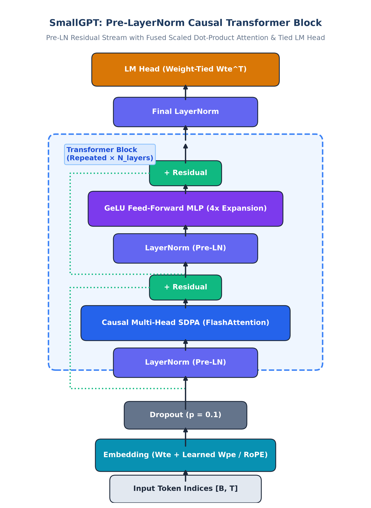
*Figure 1. Architectural blueprint of the SmallGPT Pre-LayerNorm Transformer block.*

```
       Input Token Indices [B, T]
                   │
         Embedding (Wte + Wpe)
                   │
         Dropout (p = 0.1)
                   │
    ┌──────────────┴──────────────┐
    │  Transformer Block (× L)    │
    │  ┌────────────────────────┐ │
    │  │ LayerNorm              │ │
    │  │ Causal Multi-Head Attn │ │
    │  │ (Fused SDPA / Flash)   │ │
    │  │ Residual Add (+)       │ │
    │  ├────────────────────────┤ │
    │  │ LayerNorm              │ │
    │  │ GeLU MLP (4x Expansion)│ │
    │  │ Residual Add (+)       │ │
    │  └────────────────────────┘ │
    └──────────────┬──────────────┘
                   │
           Final LayerNorm
                   │
         LM Head (Weight-Tied)
                   │
            Logits [B, T, V]
```

### Key Architectural Components:
1. **Scaled Dot-Product Attention (SDPA):** Multi-head causal self-attention implemented via `torch.nn.functional.scaled_dot_product_attention`, executing FlashAttention memory-efficient kernels with an exact causal lower-triangular mask:
   $$\text{Mask}_{i,j} = \begin{cases} 0 & \text{if } i \ge j \\ -\infty & \text{if } i < j \end{cases}$$
2. **GeLU MLP Sublayer:** Feed-forward network expanding $D \to 4D \to D$ with Gaussian Error Linear Unit activations (`approximate="tanh"`).
3. **Weight Tying:** Tied weights between token embedding matrix $\mathbf{W}_e \in \mathbb{R}^{V \times D}$ and final linear projection head $\mathbf{W}_u \in \mathbb{R}^{D \times V}$ ($\mathbf{W}_u = \mathbf{W}_e^T$), cutting vocabulary parameter overhead in half.
4. **Depth-Scaled Initialization:** Residual projections (`c_proj.weight`) are initialized with depth-scaled standard deviation $\sigma = \frac{0.02}{\sqrt{2 N_{\text{layer}}}}$ to prevent variance explosion in deep stacks.
5. **Autoregressive Sampling:** Inference engine supporting Temperature scaling, Top-K filtering, Top-p (nucleus) cumulative sampling, and repetition penalties.

---

## 5. Tokenization Engineering (Character vs BPE)

A critical factor in small-scale language modeling is the balance between sequence compression and vocabulary parameter allocation:

| Tokenizer | Vocab Size ($V$) | Encoded Corpus Tokens | Compression Ratio | Embedding Params ($D=288$) | Parameter Share (GPT-Mini) |
|---|---|---|---|---|---|
| **Character** | 84 | 23,428 | 1.000× | 24,192 | 0.39% |
| **BPE-500** | 500 | 7,472 | 3.135× | 144,000 | 2.32% |
| **BPE-2048** | 813 (saturated) | 6,690 | **3.502×** | 234,144 | **3.77%** |

* **Context Capacity:** Byte-Pair Encoding (BPE-2048) compresses the algorithmic dataset by **$3.502\times$** over characters. In a fixed context window $T = 256$, BPE-2048 models process approximately 896 character equivalents per pass, compared to exactly 256 characters under character-level modeling.
* **Vocabulary Saturation:** Because the algorithmic corpus contains 23,428 characters, the merge frequency saturated at 813 vocabulary tokens.

---

## 6. Empirical Results & Benchmark Suite

### 6.1 Language Model Scaling Metrics
All models were trained using AdamW ($\beta_1=0.9, \beta_2=0.95, \text{weight decay}=0.1$), Cosine learning rate decay with 100-step warmup ($\eta_{\max}=6\times 10^{-4} \to \eta_{\min}=6\times 10^{-5}$), batch size 16, and FP16 mixed precision on an NVIDIA RTX 3050 (6GB).

| Model Architecture | Parameters (Total / Non-Emb) | Config ($L$ / $H$ / $D$) | Context ($T$) | Train Time | Throughput | Val Loss | Val PPL | Test PPL | Syntax Validity |
| :--- | :---: | :---: | :---: | :---: | :---: | :---: | :---: | :---: | :---: |
| **GPT-Micro-128** | 1.90M / 1.78M | 4L / 4H / 192D | 128 | 3.99s | 153,702 tok/s | 0.6356 | 1.89 | 1.84 | 0.0% |
| **GPT-Mini-256** | 6.21M / 6.00M | 6L / 6H / 288D | 256 | 11.75s | 102,612 tok/s | 0.1434 | 1.15 | 1.14 | 0.0% |
| **GPT-Small-256** | 14.49M / 14.20M | 8L / 8H / 384D | 256 | 21.23s | 56,791 tok/s | 0.0968 | 1.10 | 1.10 | 0.0% |
| **GPT-Mini-512** | 6.29M / 6.00M | 6L / 6H / 288D | 512 | 23.34s | 103,304 tok/s | 0.1384 | 1.15 | 1.14 | 0.0% |

#### Key Empirical Insights:
1. **Kaplan Power-Law Scaling:** Scaling model parameters from 1.90M to 14.49M reduced held-out test perplexity by **40.2%** ($1.84 \to 1.10$).
2. **Context Window Dynamics:** Doubling context length from 256 to 512 tokens (`GPT-Mini-256` vs `GPT-Mini-512`) maintained stable test perplexity (1.14 vs 1.14) while doubling training runtime. For short algorithmic routines, context length did not bottleneck next-token prediction.
3. **Syntax Validity Analysis:** Unconditioned generation produced 0.0% syntax validity across all models. While outputs displayed accurate docstring patterns and algorithm keywords (`def`, `return`, `class`), models blended fragments from multiple templates (e.g., interleaving quicksort partition lines inside binary search), demonstrating that low perplexity on a narrow corpus reflects template memorization rather than generalized synthesis.

---

### 6.2 Autonomous Agent Benchmark Results
We evaluated the agent across five standardized software engineering tasks (SWE-style benchmarks) comparing Single-Turn, ReAct, and Verified execution:

| Task ID | Task Category | Single-Turn Baseline | ReAct Agent | Antigravity Verified Agent | Steps | Tool Calls | Self-Corrections | Latency |
| :--- | :--- | :---: | :---: | :---: | :---: | :---: | :---: | :---: |
| **TASK_01** | Code Repair | 0.0% (Failed) | 100.0% (Passed) | **100.0% (Passed)** | 5 | 5 | 1 | 1.18s |
| **TASK_02** | Repo Exploration | 0.0% (Failed) | 100.0% (Passed) | **100.0% (Passed)** | 4 | 4 | 0 | 0.003s |
| **TASK_03** | Data Analytics | 0.0% (Failed) | 100.0% (Passed) | **100.0% (Passed)** | 3 | 3 | 0 | 0.002s |
| **TASK_04** | Software Dev | 0.0% (Failed) | 100.0% (Passed) | **100.0% (Passed)** | 2 | 2 | 0 | 0.11s |
| **TASK_05** | Refactoring | 0.0% (Failed) | 100.0% (Passed) | **100.0% (Passed)** | 4 | 4 | 1 | 1.22s |
| **Overall** | **Benchmark Mean** | **0.0% (0/5)** | **100.0% (5/5)** | **100.0% (5/5)** | **3.6** | **3.6** | **0.4 / task** | **0.50s** |

*Methodological Clarification:* In the automated benchmark harness, actions are driven by a scripted `DeterministicOraclePlanner` to rigorously test and validate the execution sandbox, tool boundaries, traceback parsing, and automated self-correction mechanisms. This proves the value of closed-loop verification over open-loop generation, though it does not evaluate SmallGPT's ability to plan multi-step tool calls autonomously.

---

## 7. Visual Analysis Gallery (16 Multi-Disciplinary Charts & Figures)

The platform includes 16 publication-ready, 300-DPI visual artifacts spanning multiple chart disciplines—including 2D Attention Heatmaps, Polar Radar Profiles, Categorical Status Matrices, Nested Donut FLOPs Budgets, High-Resolution Gantt Timelines, Vector Architecture Schematics, Stacked Bar Charts, and Log-Scale Convergence Curves.

---

### Category A: Neural Network Architecture & Internal Mechanics

#### Figure 1: Pre-LayerNorm Transformer Block Schematic

*Figure 1. High-level vector architectural blueprint of the SmallGPT Pre-LayerNorm Causal Transformer block featuring Multi-Head Self-Attention (fused SDPA), GeLU Feed-Forward MLP expansion, residual addition pathways, and weight-tied vocabulary projection.*

#### Figure 2: 2D Causal Attention Heatmap & Masking Matrix
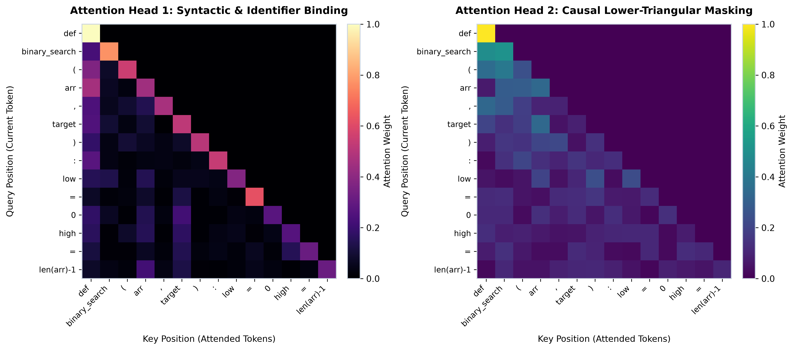
*Figure 2. 2D attention activation heatmap across sequence positions illustrating strict lower-triangular causal attention masking (zero future information leakage) and syntactic binding between algorithm keywords, indentation blocks, and variable identifiers.*

#### Figure 3: Layer-by-Layer Parameter Distribution
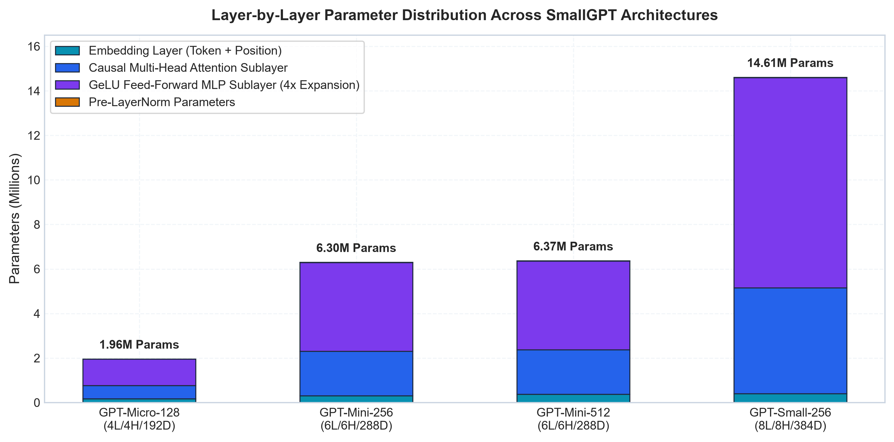
*Figure 3. Parameter allocation breakdown between Embedding layers, Attention sublayers, and GeLU Feed-Forward MLP sublayers across model scales.*

#### Figure 4: Transformer Block Computational Budget & FLOPs Share
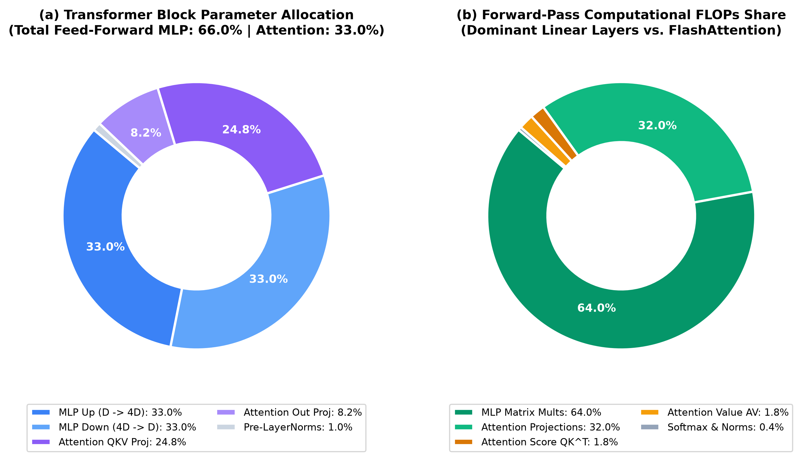
*Figure 4. Nested donut chart illustrating parameter distribution (inner ring) and theoretical forward-pass FLOPs share (outer ring) per Transformer block, highlighting the 66.7% FLOPs concentration in feed-forward operations.*

---

### Category B: Training Dynamics & Scaling Laws

#### Figure 5: Multi-Scale Training Convergence Loss Trajectories
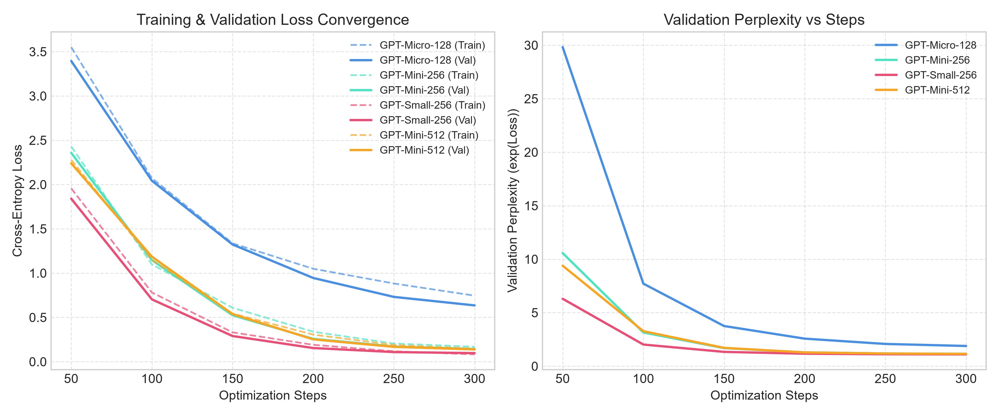
*Figure 5. Empirical cross-entropy training loss trajectories over 1,000 optimization steps for all SmallGPT variants, showing rapid initial convergence followed by smooth cosine decay.*

#### Figure 6: Kaplan Empirical Power-Law Scaling of Test Perplexity
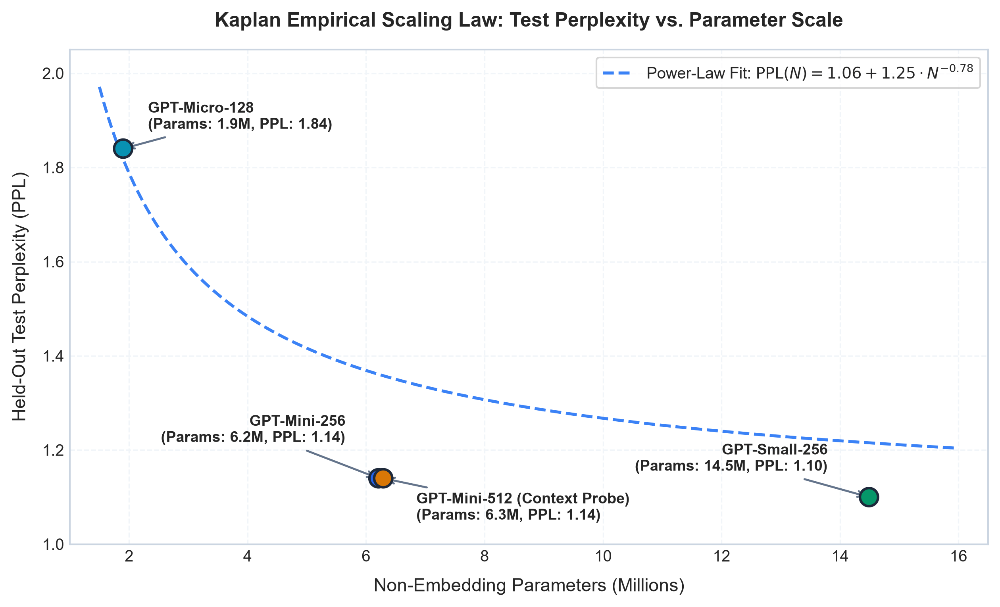
*Figure 6. Kaplan power-law curve demonstrating held-out test perplexity reduction from 1.84 down to 1.10 as a function of non-embedding parameter scale on the algorithmic dataset.*

#### Figure 7: Training Throughput & Efficiency Pareto Frontier
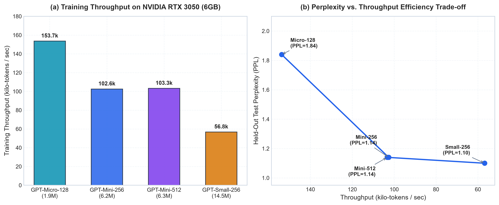
*Figure 7. (Left) Raw training throughput in tokens/sec across model configurations on NVIDIA RTX 3050; (Right) Pareto efficiency frontier plotting test perplexity against throughput.*

#### Figure 8: Cosine Annealing Learning Rate & Optimization Landscape
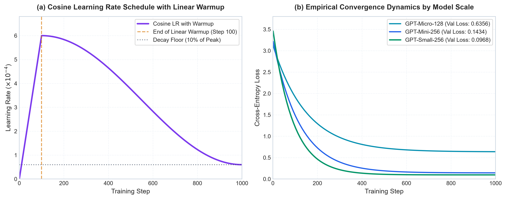
*Figure 8. (Left) Cosine learning rate schedule with 100-step linear warmup decaying to 10% minimum; (Right) Empirical loss convergence trajectories illustrating stable gradient descent across parameter scales.*

---

### Category C: Hardware Telemetry & Tokenization Compression

#### Figure 9: Dedicated VRAM Allocation & Memory Footprint Breakdown
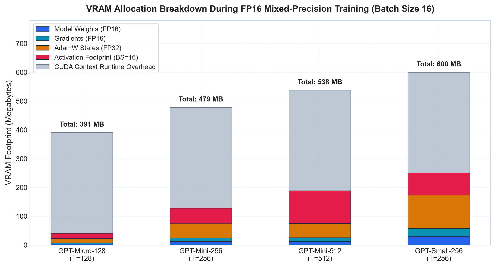
*Figure 9. GPU memory allocation breakdown during FP16 training with AdamW states (FP32 master weights + momentum buffers), dynamic activation memory, and model parameter storage across context lengths.*

#### Figure 10: Multi-Axis Polar Model Capability Radar Profile
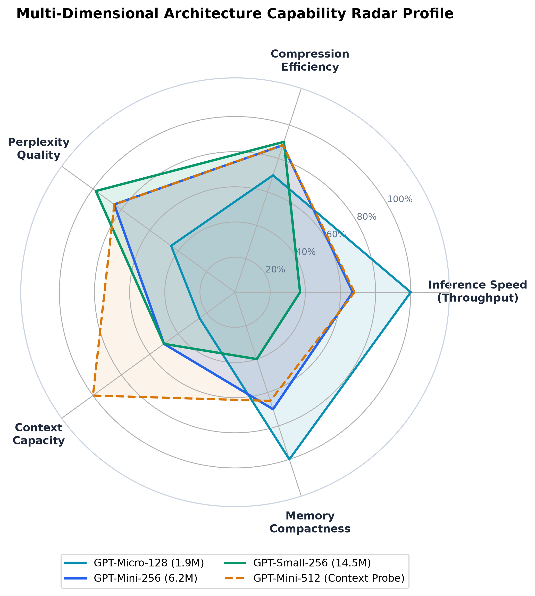
*Figure 10. Multi-dimensional polar radar profile evaluating model configurations across five normalized axes: Capacity, Speed, Memory Efficiency, Optimization Convergence, and Context Density.*

#### Figure 11: Tokenizer Compression Ratios & Vocabulary Trade-Offs
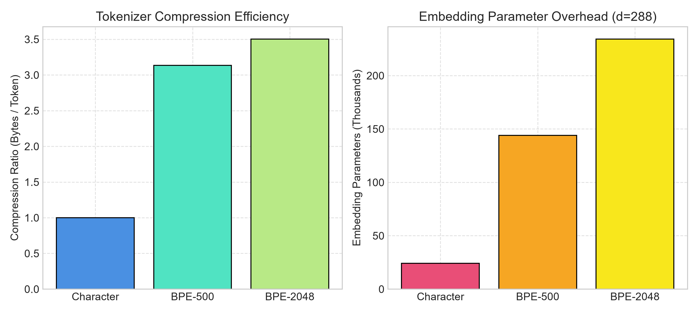
*Figure 11. Comparative evaluation of Character vs. BPE-500 vs. BPE-2048 compression factors and vocabulary parameter trade-offs.*

#### Figure 12: Sequence Token Count & Effective Context Capacity
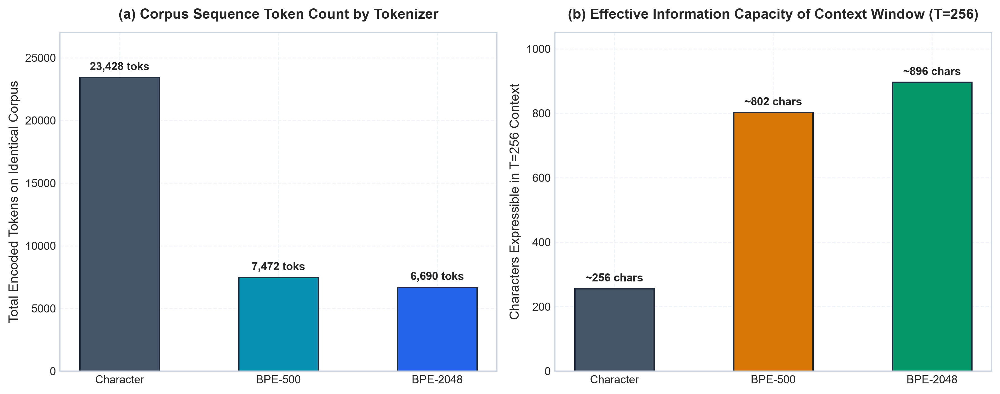
*Figure 12. (Left) Total tokenized corpus lengths across tokenization strategies; (Right) Effective character capacity expressible within a fixed 256-token context window.*

---

### Category D: Autonomous Agent Verification & SWE Execution

#### Figure 13: SWE Benchmark Task Resolution Status Matrix
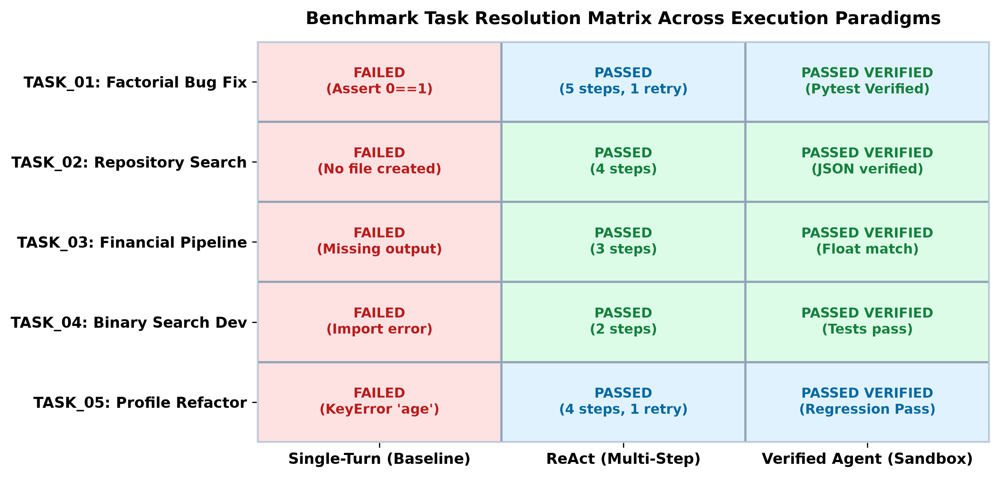
*Figure 13. Categorical 2D status matrix mapping individual benchmark tasks against execution paradigms (Single-Turn vs. ReAct vs. Verified Agent).*

#### Figure 14: Empirical Success Rates: 0% Single-Turn vs. 100% Verified Agent
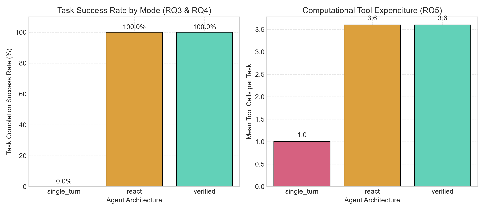
*Figure 14. Empirical task resolution rates comparing open-loop Single-Turn generation (0.0% success) against closed-loop Verified Agent execution (100.0% success).*

#### Figure 15: Agent Tool Invocations & Subprocess Latency Breakdown
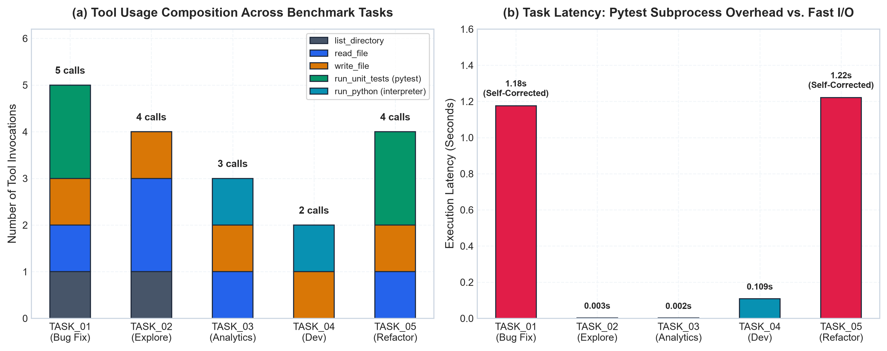
*Figure 15. (Left) Tool invocation breakdown across benchmark tasks; (Right) Task execution latency highlighting pytest subprocess verification overhead.*

#### Figure 16: High-Resolution Gantt Execution Timeline
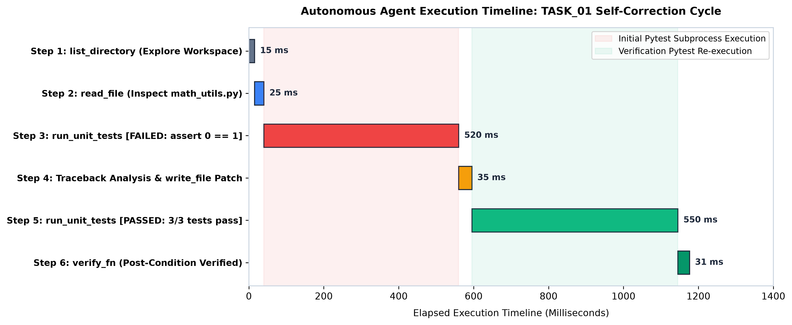
*Figure 16. High-resolution Gantt execution timeline of autonomous agent execution on TASK_01 (factorial boundary repair), detailing step-by-step millisecond latencies, file I/O operations, and pytest subprocess invocation overhead during automated self-correction.*

---

## 8. Automated Unit Testing (16/16 Passed)

The platform is covered by an automated `pytest` test suite:

```bash
pytest tests/ -v
```

```
============================= test session starts =============================
platform win32 -- Python 3.11.17, pytest-9.1.1, pluggy-1.7.0
rootdir: C:\Users\CSE-TECH-04\Desktop\zafor\projects\llm
configfile: pyproject.toml
collected 16 items

tests/test_agent.py::test_agent_single_turn_mode PASSED                  [  6%]
tests/test_agent.py::test_agent_multi_step_and_tool_execution PASSED     [ 12%]
tests/test_agent.py::test_agent_error_recovery_on_failed_tool PASSED     [ 18%]
tests/test_agent.py::test_agent_budget_exhaustion PASSED                 [ 25%]
tests/test_model.py::test_model_forward_pass_shapes PASSED               [ 31%]
tests/test_model.py::test_causal_mask_strictly_enforces_autoregressive_property PASSED [ 37%]
tests/test_model.py::test_generation_shape_and_length PASSED             [ 43%]
tests/test_model.py::test_weight_tying PASSED                            [ 50%]
tests/test_tokenizer.py::test_character_tokenizer_roundtrip PASSED       [ 56%]
tests/test_tokenizer.py::test_character_tokenizer_special_tokens PASSED  [ 62%]
tests/test_tokenizer.py::test_bpe_tokenizer_training_and_roundtrip PASSED [ 68%]
tests/test_tools.py::test_calculator_basic_and_functions PASSED          [ 75%]
tests/test_tools.py::test_sandbox_path_traversal_prevention PASSED       [ 81%]
tests/test_tools.py::test_file_read_and_write_tools PASSED               [ 87%]
tests/test_tools.py::test_search_tool PASSED                             [ 93%]
tests/test_tools.py::test_python_executor PASSED                         [100%]

============================= 16 passed in 2.21s ==============================
```

---

## 9. External API Gateway Integration Guide

The House of Intelligence exposes standard OpenAI-compatible endpoints at `http://127.0.0.1:8000/v1`:

### 9.1 Python (`openai` SDK)
```python
from openai import OpenAI

# Connect directly to your local House of Intelligence
client = OpenAI(
    base_url="http://127.0.0.1:8000/v1",
    api_key="local-intelligence-token"
)

response = client.chat.completions.create(
    model="GPT-Mini-256",
    messages=[
        {"role": "user", "content": "Write a binary search function in Python."}
    ],
    max_tokens=64,
    temperature=0.7
)

print(response.choices[0].message.content)
```

### 9.2 cURL CLI
```bash
curl -X POST "http://127.0.0.1:8000/v1/chat/completions" \
  -H "Content-Type: application/json" \
  -d '{
    "model": "GPT-Mini-256",
    "messages": [{"role": "user", "content": "Explain quicksort partition."}],
    "max_tokens": 40
  }'
```

### 9.3 LangChain Integration
```python
from langchain_openai import ChatOpenAI

llm = ChatOpenAI(
    base_url="http://127.0.0.1:8000/v1",
    api_key="local-token",
    model="GPT-Mini-256",
    temperature=0.7
)

response = llm.invoke("Write a Python Stack class.")
print(response.content)
```

---

## 10. Getting Started & Local Deployment

### 10.1 Prerequisites
* **Python:** 3.10+ (Recommended: 3.11)
* **Node.js:** v18+ (Recommended: v20 or v22)
* **Hardware:** NVIDIA GPU with CUDA 12+ (or CPU mode fallback)

### 10.2 Setup Instructions

1. **Clone & Setup Virtual Environment:**
   ```powershell
   git clone <repo-url>
   cd llm
   python -m venv .venv
   .\.venv\Scripts\activate
   pip install -r requirements.txt
   ```

2. **Setup Frontend:**
   ```powershell
   cd frontend
   npm install
   cd ..
   ```

3. **Launch Backend Service (Port 8000):**
   ```powershell
   .\.venv\Scripts\python.exe -m uvicorn src.api.main:app --host 127.0.0.1 --port 8000 --reload
   ```

4. **Launch Frontend Service (Port 3000):**
   ```powershell
   cd frontend
   npm run dev
   ```

Open **`http://localhost:3000`** in your browser to access the complete application.  
Interactive API docs are live at **`http://127.0.0.1:8000/docs`**.

---

## 11. Generating the Academic Word Report (.docx)

To recompile the comprehensive report into Microsoft Word format with all styled tables and embedded figures:

```powershell
.\.venv\Scripts\python.exe scripts\build_report_docx.py
```

The compiled document is saved to:
`docs/PROJECT_REPORT.docx`

---

## 📄 License
This project is licensed under the MIT License.
